# Lab5_javascript
# LAPORAN PRAKTIKUM LAB 5 JAVASCRIPT
Nama    : Restu Aji Prasetyo
NIM     : 312510034
Kelas   : I252A

# Berikut dibawah ini hasil dari perubahan step by step

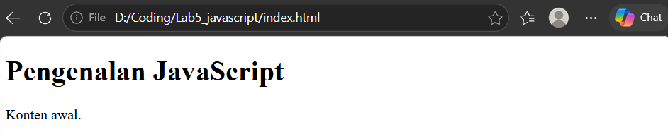
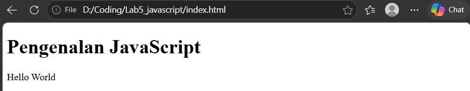
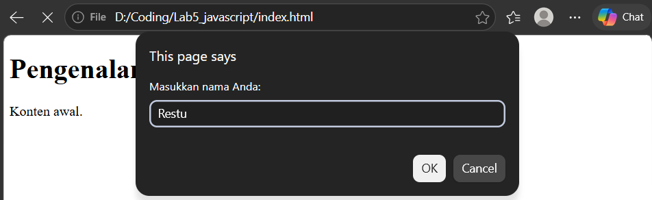
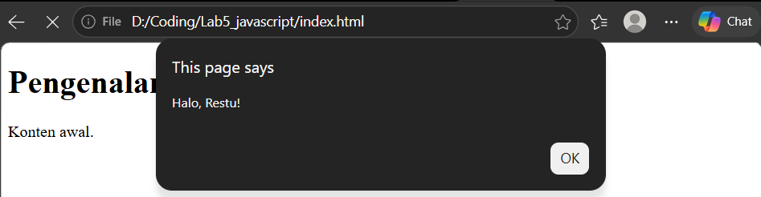
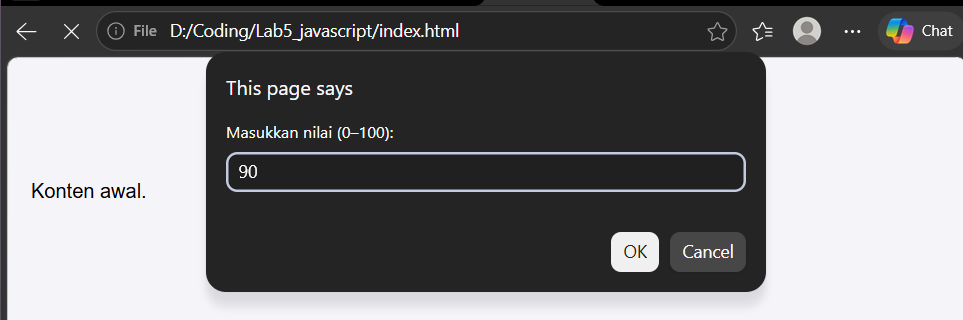
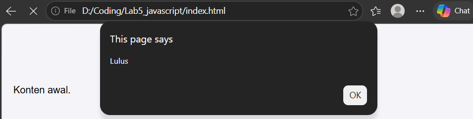
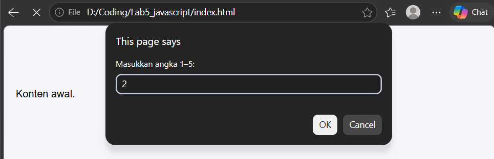
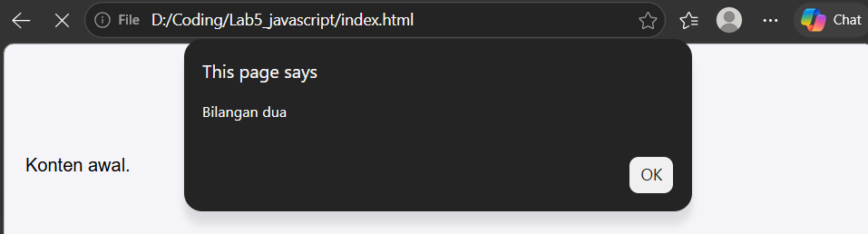
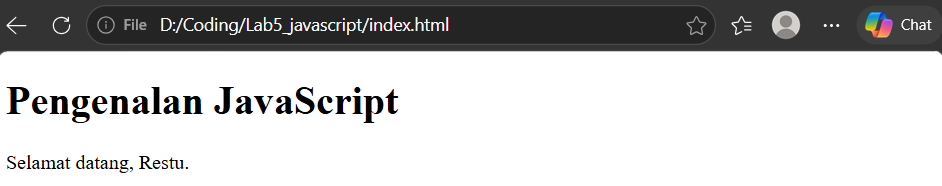
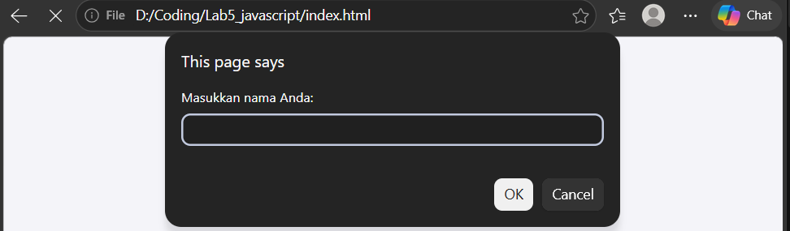
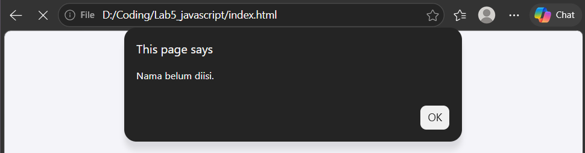
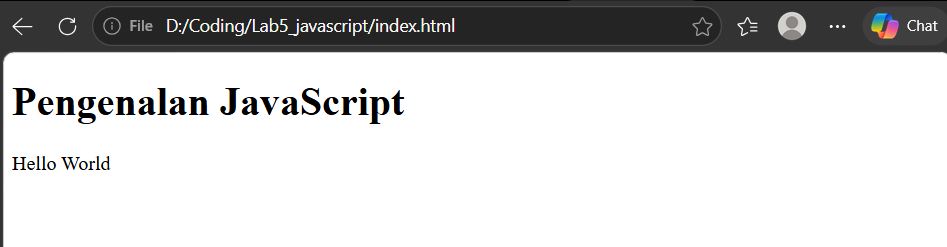
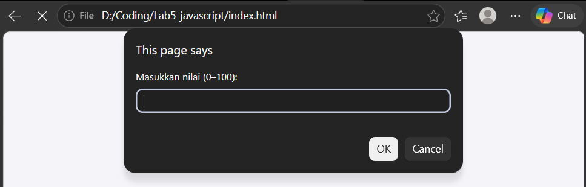
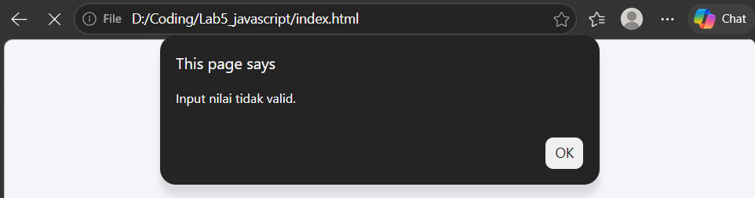
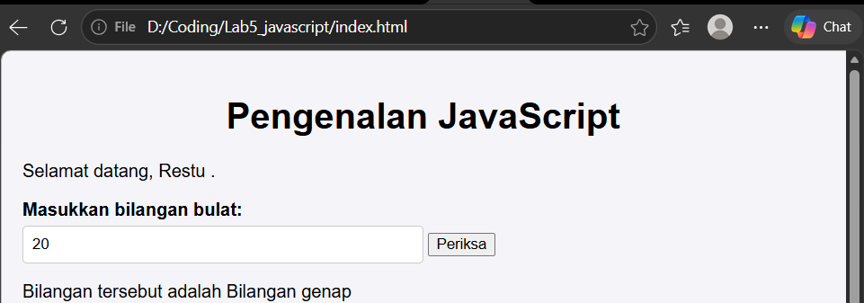
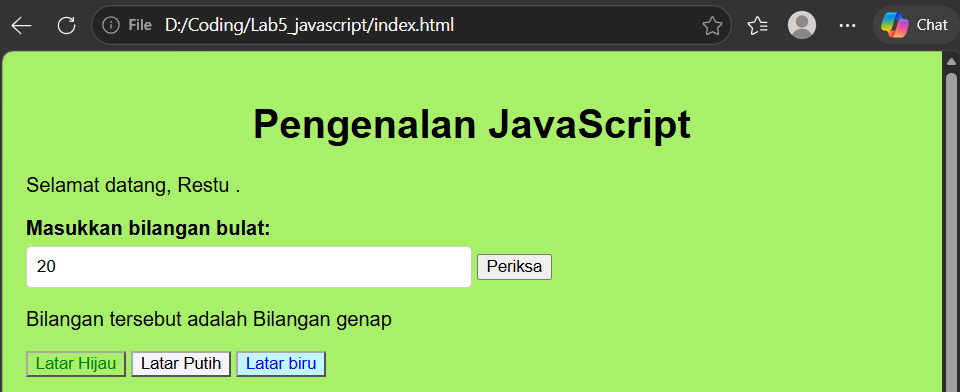
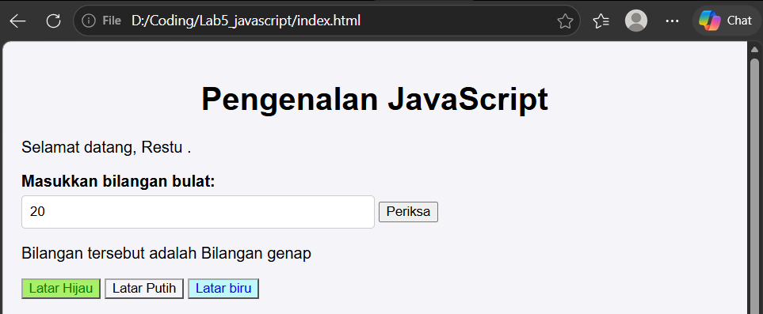
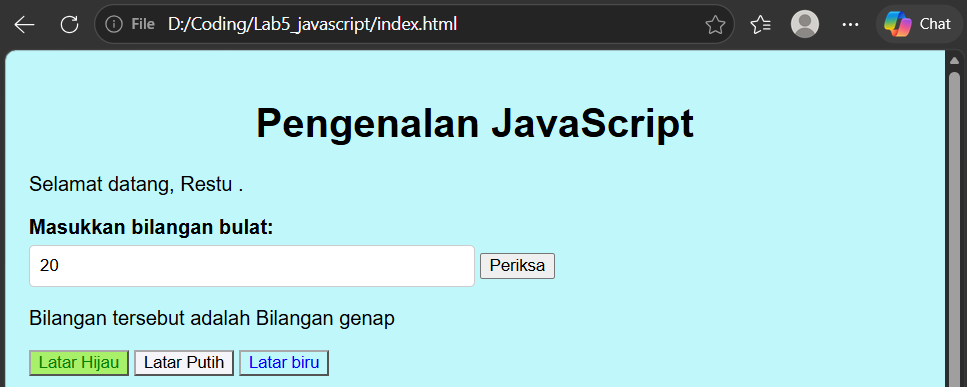
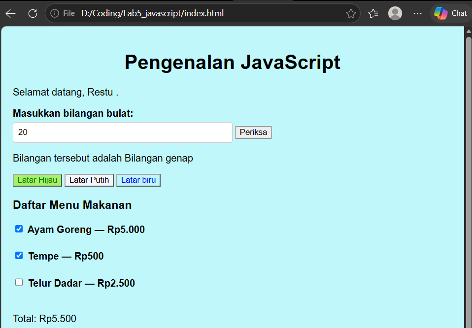
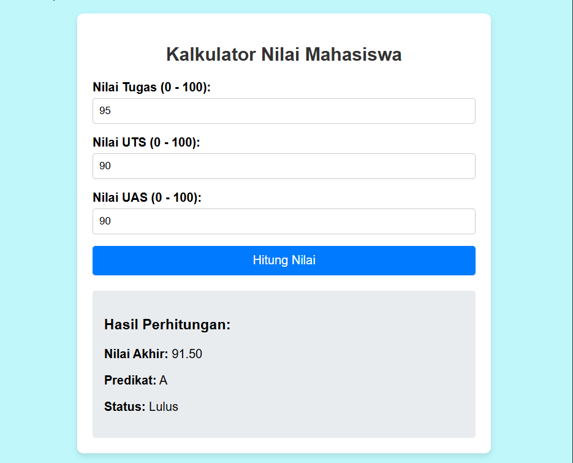
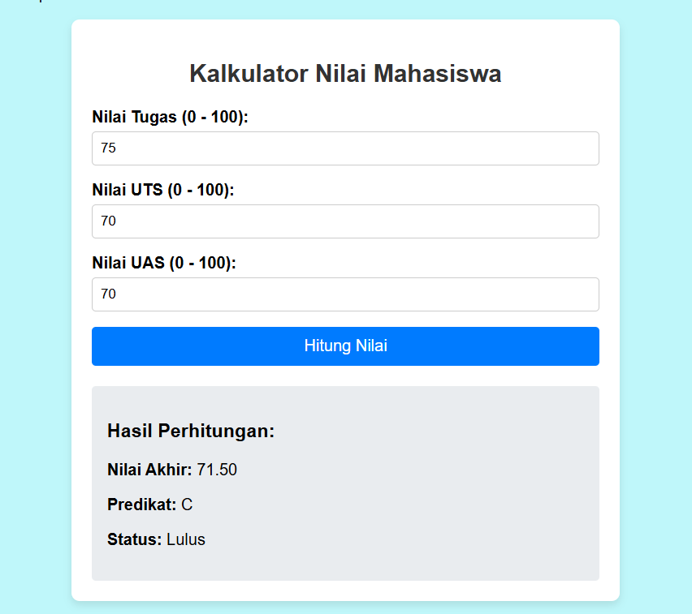
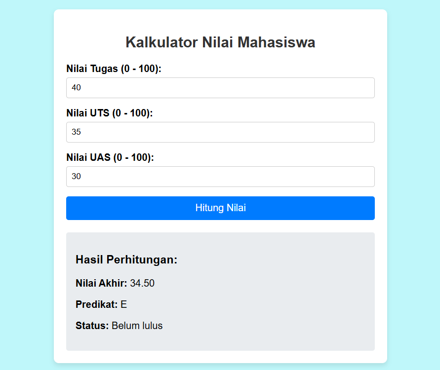
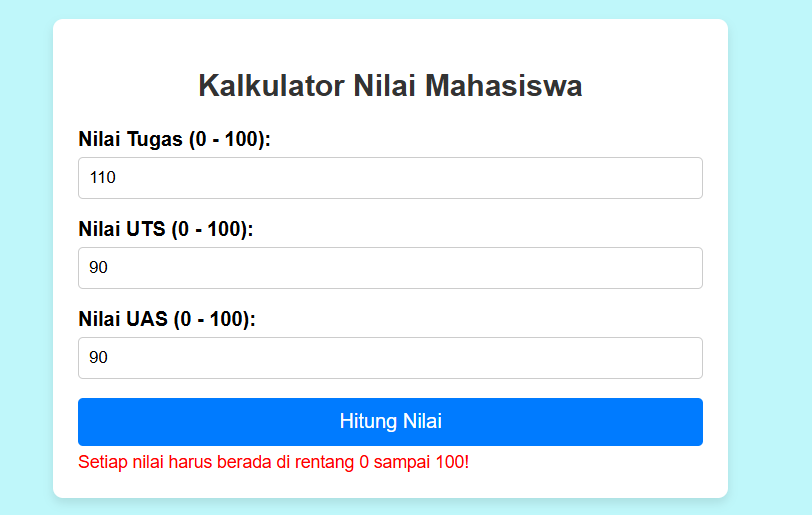

